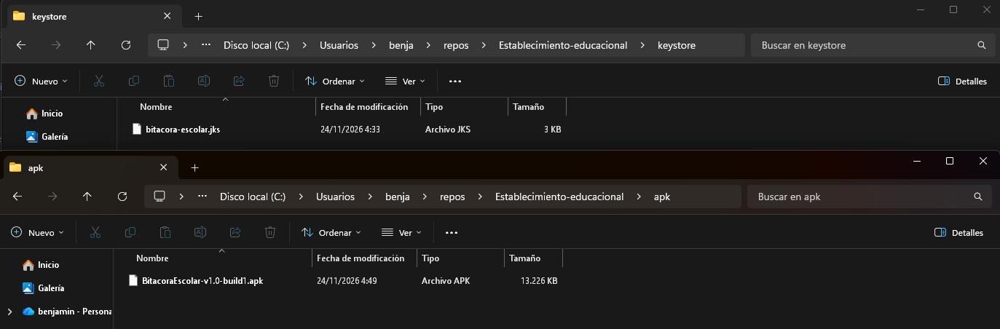
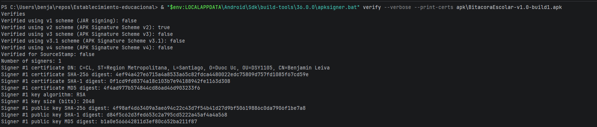

# Bitácora Escolar · DSY1105

App Android para el caso **"Bitácora"**: bitácoras mensuales de aprendizaje por curso y asignatura (5° a 8° básico), con un perfil **docente** y uno **estudiante**. El docente crea, edita, publica, cierra y elimina bitácoras, revisa los aportes y deja retroalimentación. El estudiante registra lo que aprendió en cada clase, con fotos y enlaces como evidencia.

La app guarda los datos de las bitácoras en un **microservicio Spring Boot + MySQL** (consumido con **Retrofit**) y muestra los **feriados de Chile** desde una **API externa**.

## Integrantes

| Nombre | Rol en el proyecto |
|---|---|
| Alen Gallardo | Base del proyecto, modelo de datos, Room, validaciones y login. Retrofit, repositorios, microservicio de bitácoras, pruebas de repositorios y utilidades, README |
| Benjamín Leiva | Módulos docente y estudiante, cámara y galería, animaciones y navegación. ViewModels con Retrofit, feriados, eliminar, microservicio de registros, pruebas de ViewModels, APK firmado |

## Planificación y repositorios

- **Trello:** [Tablero del proyecto](https://trello.com/invite/b/6ad6d5f67d0229f6b9b4501f/ATTI38492a0cf5091200dca157743621a751EB91C3A1/bitacora-escolar)
- **Frontend (esta app):** https://github.com/alegallardop-cmyk/Establecimiento-educacional
- **Backend (microservicio):** https://github.com/alegallardop-cmyk/Establecimiento-educacional-backend

## Funcionalidades

**Docente**
- Dashboard con indicadores (activas, borradores, cerradas, aportes por revisar) y avisos internos.
- Crear (POST) y **editar** (PUT) bitácoras: mes, año, título, propósito, instrucciones y preguntas orientadoras.
- Publicar y cerrar bitácoras (PUT). No se repite la misma asignación en el mismo mes.
- **Eliminar** una bitácora en borrador (DELETE), con confirmación.
- Detalle con informe mensual: participación, estudiantes sin participar, filtros por estudiante, fecha y estado, y **feriados del mes** (API externa).
- Revisar aportes (con sus fotos y enlaces), dejar un comentario y marcarlos como revisados (PUT).
- Historial de todas sus bitácoras con búsqueda y filtro por estado.

**Estudiante**
- Dashboard con indicadores (activas, enviados, revisados, borradores) y avisos.
- Ver las bitácoras publicadas de su curso y los **feriados del mes**.
- Crear registros de clase (POST), guardarlos como borrador, editarlos (PUT) y enviarlos (con confirmación).
- **Eliminar** un borrador (DELETE), con confirmación.
- Evidencias: foto desde la **galería** (Photo Picker) o la **cámara**, con vista previa, y enlaces.
- "Mis aportes": historial y seguimiento de sus registros (borrador, pendiente, revisado) y la retroalimentación del docente.

**Control de acceso:** cada ruta revisa el perfil (`Sesion.esDocente()` / `esEstudiante()`), y cada ViewModel revisa que el dato le pertenezca (bitácora del docente, curso del estudiante, registro propio).

**Estados de carga, éxito y error:** mientras se consultan los datos del microservicio se muestra un indicador de carga; si sale bien se ven los datos o un mensaje verde; si el servidor está apagado, un mensaje con el botón **Reintentar**. Al volver a una pantalla (`ON_RESUME`) los datos se piden de nuevo al servidor.

## ¿Qué se guarda dónde?

| Microservicio (Spring Boot + MySQL) | Room (en el teléfono) | API externa (solo lectura) |
|---|---|---|
| Bitácoras, registros, evidencias y retroalimentación | Usuarios y login, cursos, asignaturas, asignaciones, recordatorios | Feriados de Chile (Nager.Date) |

Los datos del servidor traen solo ids (`asignacionId`, `estudianteId`). Los repositorios de la app buscan en Room los nombres (curso, asignatura, estudiante) y los juntan en `BitacoraConNombres` y `RegistroConEstudiante`. Los feriados **no se guardan** ni se mezclan con nuestros datos: solo se muestran.

## Endpoints

### Microservicio propio (Spring Boot) · `http://10.0.2.2:8080/`

`10.0.2.2` es el computador visto desde el emulador. Desde el navegador del PC es `http://localhost:8080/`.

| Método | Endpoint | Uso en la app |
|---|---|---|
| GET | `/bitacoras` | Listar bitácoras (docente, estudiante, historial) |
| GET | `/bitacoras/{id}` | Detalle de una bitácora |
| POST | `/bitacoras` | Crear bitácora |
| PUT | `/bitacoras/{id}` | Editar bitácora |
| PUT | `/bitacoras/{id}/publicar` | Publicar |
| PUT | `/bitacoras/{id}/cerrar` | Cerrar |
| DELETE | `/bitacoras/{id}` | Eliminar (solo borradores) |
| GET | `/registros?bitacoraId=` · `/registros?estudianteId=` | Aportes de una bitácora / de un estudiante |
| GET | `/registros/{id}` | Ver un aporte |
| POST | `/registros` | Crear registro (borrador o enviado) |
| PUT | `/registros/{id}` | Editar o enviar un borrador |
| PUT | `/registros/{id}/retroalimentacion` | Comentario del docente y "revisado" |
| DELETE | `/registros/{id}` | Eliminar un borrador |

Los JSON de ejemplo están en el README del backend.

### API externa · Nager.Date (pública, sin clave)

| Método | Endpoint | Uso en la app |
|---|---|---|
| GET | `https://date.nager.at/api/v3/PublicHolidays/{año}/CL` | Feriados de Chile del año; la app muestra solo los del mes de la bitácora |

## Cómo ejecutar

1. **Backend:** tener MySQL encendido (XAMPP o Laragon) y ejecutar el proyecto `Establecimiento-educacional-backend` en IntelliJ (`EstablecimientoEducacionalApplication`). Probar `http://localhost:8080/bitacoras` en el navegador.
2. **App:** abrir este proyecto en Android Studio, esperar el *Gradle Sync* y ejecutar en un **emulador** (▶ Run).
3. **Si la app ya estaba instalada** con la versión anterior: desinstalarla primero (la base Room cambió).
4. Entrar con una cuenta de prueba (contraseña `12345678`):
   - Docente: `ana.fuentes@escuela.cl`
   - Estudiante: `martina.soto@escuela.cl`

## Pruebas unitarias y cobertura

- **JUnit 4** con el patrón *Arrange – Act – Assert*, en `app/src/test`.
- No se usa internet ni base de datos real: los ViewModel y repositorios reciben **fakes** (`fakes/`), que son un microservicio falso, una API de feriados falsa y DAOs de Room falsos con listas en memoria.
- `MainDispatcherRule` reemplaza el hilo principal para poder probar `viewModelScope`.
- **Kover** mide la cobertura de la lógica: validaciones, fechas, indicadores, sesión, repositorios y ViewModels.

```
./gradlew :app:testDebugUnitTest          → ejecutar las pruebas
./gradlew :app:koverHtmlReportDebug       → reporte en app/build/reports/kover/htmlDebug/index.html
```

## APK firmado

| Elemento | Valor |
|---|---|
| Keystore | `keystore/bitacora-escolar.jks` (clave **solo de demostración académica**) |
| Alias | `bitacora` |
| Contraseñas | En `keystore.properties` (fuera de Git). En el repo está `keystore.properties.ejemplo` |
| Versión | `versionCode = 1`, `versionName = "1.0"` |
| APK | `apk/BitacoraEscolar-v1.0-build1.apk` |

**Pasos para generar el APK firmado**

1. Crear el keystore en Android Studio: *Build → Generate Signed App Bundle or APK → APK → Create new...* (se guarda en `keystore/`).
2. Copiar `keystore.properties.ejemplo` con el nombre `keystore.properties`. `app/build.gradle.kts` lo lee y configura `signingConfigs` para `release`.
3. Generar el APK con nombre versionado:
   ```
   .\gradlew :app:exportarApkRelease
   ```
   Queda en `app/build/apk-exportadas/BitacoraEscolar-v1.0-build1.apk`.
4. Verificar la firma (Android SDK → build-tools):
   ```
   apksigner verify --verbose --print-certs BitacoraEscolar-v1.0-build1.apk
   ```
5. Instalar y probar en el emulador: `adb install -r BitacoraEscolar-v1.0-build1.apk`.

Para publicar una versión nueva sin perder los datos se sube `versionCode` y se firma con **la misma** clave.

**Evidencia**





## Estructura

```
cl/duoc/bitacora_escolar/
├── MainActivity.kt          → Dependencias.iniciar() + Tema + Navegacion()
├── model/                   → entidades Room, modelos del microservicio, estados y clases "ConNombres"
├── data/
│   ├── remote/              → RetrofitClient, BitacoraApi, RegistroApi, FeriadosApi, Respuestas
│   ├── *Dao.kt, AppDatabase → Room (datos locales)
│   ├── *Repository.kt       → juntan microservicio + Room
│   ├── Dependencias.kt      → crea los repositorios una vez
│   └── Sesion.kt, DatosDePrueba.kt
├── navigation/              → Rutas.kt y Navegacion.kt
├── ui/
│   ├── theme/ · componentes/
│   ├── login/
│   ├── docente/             → inicio, formbitacora, detalle, revision, historial
│   ├── estudiante/          → inicio, bitacora, registro, historial
│   └── feriados/            → FeriadosUiState, FeriadosViewModel y SeccionFeriados (API externa)
└── util/                    → Validaciones, Fechas, Indicadores, CamaraUtils, Mensajes
```

Patrón **MVVM**: cada pantalla tiene `XxxScreen` (Compose), `XxxViewModel` (lógica de presentación) y `XxxUiState` (solo el estado, en un `StateFlow`). Los composables reutilizables (`Cargando`, `ErrorConexion`, `ConfirmarEliminar`, tarjetas...) están en `ui/componentes`. El ViewModel recibe sus repositorios por parámetro (con valor por defecto), así en las pruebas se le pueden pasar fakes.
